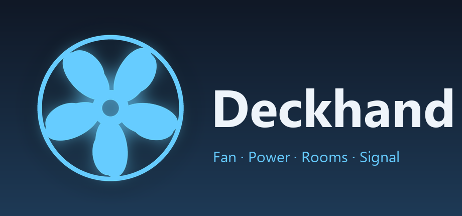

# Deckhand

A companion app for the **Valve Steam Frame**: big, VR-friendly settings and tools that SteamOS
doesn't have (yet). Runs from your Steam library, in VR, no desktop mode needed.



## What it does

| Tab | |
|---|---|
| **Fan** | Turn down the fan that blows on your eyes: quiet presets, strength, charging floor. |
| **Power** | Shut down for real, sleep timer, auto shut-off after standby (no more dead battery). |
| **Timer** | Kitchen timer with a countdown that floats in view for the last minute. Name your timers. |
| **Reminders** | A popup in the headset at a set time and date. |
| **Comfort** | Screenshot blocker (no accidental screenshots), other comfort toggles. |
| **Rooms** | Save and name play areas, preview them, load one instead of redrawing the boundary. Ceiling indicator for lying down. |
| **Signal** | Home Wi-Fi *and* Steam dongle signal, live. Play-space map shows the best spot to stand; whole-house map walks your home into a floor plan coloured by signal that you can drag, rotate and zoom, with a "You" marker and a game-style mini-map in the middle of your view. |
| **Recline** | Controls for Recline VR (play lying down). |
| **System** | Headset info, restart SteamVR, **Update app**. |

## Install

On the Frame, switch to **Desktop mode**, open **Konsole**, type this and press Enter:

```bash
curl -L is.gd/deckhandvr|sh
```

(`is.gd/deckhandvr` is a short link to this repo's `install.sh`. The full command, if you'd rather paste it:
`curl -fsSL https://raw.githubusercontent.com/SkillNotRequired/deckhand/main/install.sh | bash`)

It installs into `~/Deckhand`, builds its small helpers (g++ ships with SteamOS on the Frame), and adds
Deckhand to your Steam library and app menu. Then go back to Game mode and open it like any game.

**Fan control** (optional) needs a one-time step with your password:

```bash
sudo ~/Deckhand/setup.sh
```

No password yet? Set one with `passwd`. This installs only a small fan helper that the app may run
without a password; `sudo ~/Deckhand/setup.sh remove` undoes it and puts the fan back to stock.

## What's in the folder

```
Deckhand/
├── install.sh     install or reinstall (the one-line command runs this)
├── uninstall.sh   remove everything (System tab > Remove Deckhand runs this)
├── setup.sh       optional, once, with sudo: lets the app change the fan
├── launch.sh      what Steam starts
├── app/           the app (deckhand.py) and its parts
├── helpers/       small native SteamVR helpers: src/ is built into bin/ on the Frame
├── assets/        icon and Steam artwork
├── tools/         artwork generator (only needed on a PC)
└── logs/          run logs, for troubleshooting
```

## Update

System tab > **Check for update**, then **Update**, then **Restart Deckhand**. Or run the install
command again (do that once if you installed 1.0.4 or older: the folder layout changed in 1.0.5). Your settings, rooms and maps are kept
(they live in `~/.config/frame-settings` and `~/.local/share/frame-settings`).

## Remove

System tab > **Remove Deckhand**. It warns you first, then removes the app, its Steam and app-menu
entries, its background jobs and the fan helper (fan back to stock); tick the box to keep your saved
rooms and maps. From Konsole: `~/Deckhand/uninstall.sh` (or `--keep-data`).

## Notes

- The house map shows where you walked (dashed edge), your path, labels and a yellow "You" arrow. Pick a
  tool above it: **Move** (drag), **Zoom** (tap to zoom in there, right-click to zoom out), **Labels**, or
  **Signal** (tap a spot to see both links' strength there). Rotate / zoom / find me / reset are below it.
- Signal maps use a colour-blind-safe gradient (dark purple = weak → yellow = strong) with a dBm scale.
- The dongle's strength is how loudly the Frame hears the PC's dongle (its 6 GHz link); it only shows
  while the PC and Steam are on.
- Not made by or affiliated with Valve. Use at your own risk.
